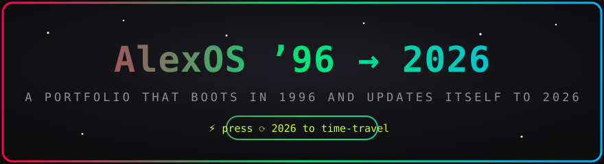
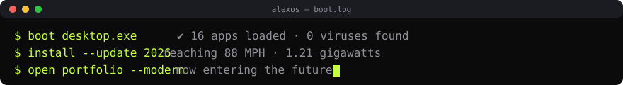
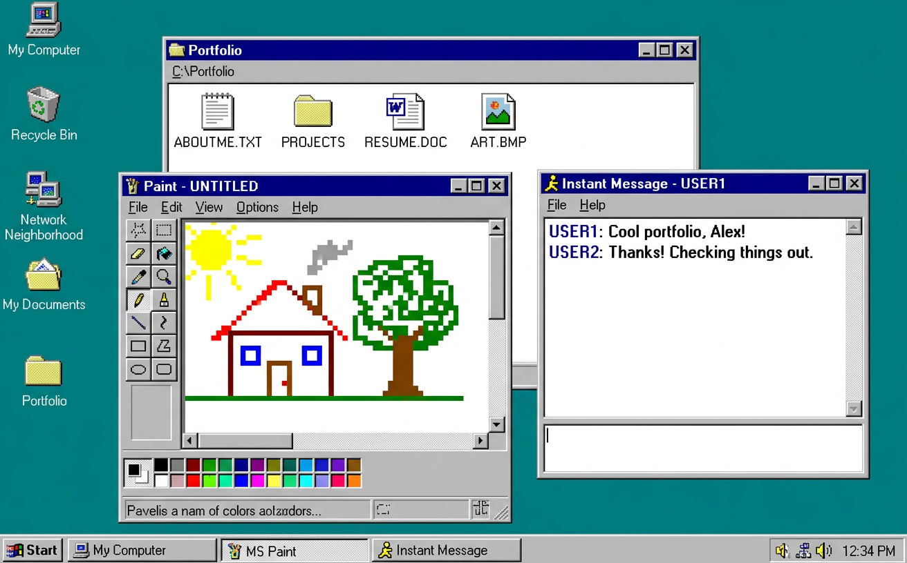

<div align="center">





[](https://developer.mozilla.org/docs/Web/HTML)
[](https://developer.mozilla.org/docs/Web/CSS)
[](https://developer.mozilla.org/docs/Web/JavaScript)
[]()
[](https://pages.github.com/)
[](LICENSE)

</div>


## 🌈 What is this?

A portfolio that is **two websites in one**: it boots as a fully working **retro 1996 desktop OS** — windows, taskbar, start menu, games, paint, a chat bot, a screensaver — and when you press **⟳ 2026**, the whole thing time-travels through a light-speed vortex and lands in a **sleek, dark, animated 2026 portfolio**.

No frameworks. No build step. Just **HTML + CSS + vanilla JavaScript**, canvas physics, WebAudio chiptunes and an unreasonable love for the year 1996.

<div align="center">

</div>


## ✨ The Experience

| 🖥️ **1996 Layer**                          | ⚡ **2026 Layer**                                    |
| ------------------------------------------ | ---------------------------------------------------- |
| Boot splash with blinking “click to start” | Particle hero that **assembles your name** from dust |
| Draggable windows + taskbar + start menu   | Scroll-progress bar + aurora backdrop                |
| 16 working apps (see below 👇)             | Word-rain canvas that coalesces into your mission    |
| “Did you know?” tip popups + Clippy 📎     | Swipeable case-study cards with live dots            |
| Idle 45s → **starfield screensaver**       | Big-type statement, capsule skill cards              |
| Sleep · Shut Down · Restart (all real)     | Animated contact section + hiring toast              |
| Pixel-art custom cursors                   | Neon-lime custom cursors                             |


## 🕹️ Every App Works

| Icon | App                   | What it actually does                                                                 |
| :--: | --------------------- | ------------------------------------------------------------------------------------- |
|  🗂️  | **Selected Work**     | Folder of 8 projects; each opens a project dossier + case-study link                  |
|  📝  | **About Me**          | Notepad-style bio                                                                     |
|  🅦   | **What I Do**         | Skills window, three columns                                                          |
|  🛰️  | **Now (2026)**        | “Now page” in a window                                                                |
|  ✉️  | **Contact**           | One-tap email / phone / LinkedIn                                                      |
|  📄  | **Résumé.pdf**        | In-window PDF viewer + real `resume.pdf` download                                     |
|  🎨  | **Kid Pix**           | Full paint app: 12 colors, brush sizes, stamps, eraser, undo, 💣 clear, 💾 PNG export |
|  ❓  | **Pop Culture Quiz**  | 5-question quiz with scoring + restart                                                |
|  📎  | **Clippy Help**       | The assistant. Rotating tips. Blinking eyes.                                          |
|  🎮  | **Games**             | Fully playable **Minesweeper** (flags, timer, face) & **Snake** (keyboard + swipe)    |
|  💬  | **AIMS**              | Instant-messenger bot that answers about work, hiring, 2026…                          |
|  🖼️  | **Backgrounds**       | 5 wallpapers, persisted to `localStorage`                                             |
|  🎵  | **Napster**           | Chiptune player — every track **synthesized live** with WebAudio                      |
|  📺  | **Nostalgia Moments** | Timeline of the decade that made us                                                   |
|  🕰️  | **Time Travel**       | Flux-capacitor control panel → 88 MPH → 2026                                          |
|  🗑️  | **Recycle Bin**       | Questionable files. Emptiable.                                                        |


## 🚀 Quick Start (see the preview)

**Option 1 — just open it:** double-click `index.html`. It runs from the filesystem.

**Option 2 — local server (recommended, exactly like production):**

```bash
# from the project root
python3 -m http.server 8080
# then open http://localhost:8080
```

```bash
# or, if you prefer Node
npx serve .
```

Then: click anywhere to boot → explore the desktop → hit **⟳ 2026** in the taskbar.


## 🔧 Make It Yours (5-minute personalization)

| What                       | Where                                                     | Change                                                     |
| -------------------------- | --------------------------------------------------------- | ---------------------------------------------------------- |
| 🧑 Your name, email, links | `js/app.js` → `CONFIG` (top of file)                      | One object — drives hero, OS name, contact windows         |
| 🗂️ Your projects           | `js/app.js` → `PROJECTS`                                  | 8 entries; drive the retro folder **and** the modern cards |
| 📝 Case-study pages        | `build_work_pages.py` → run `python3 build_work_pages.py` | Regenerates all 8 pages in `work/`                         |
| 🖼️ Images                  | `assets/img/`                                             | Replace `portrait.jpg` + `work-*.jpg` (keep filenames)     |
| 📄 Résumé                  | `resume.pdf`                                              | Drop in your real PDF (same filename)                      |
| 🎨 Colors                  | `css/style.css` → `:root`                                 | Teal desktop, lime accent, fonts                           |


## 🗂️ Project Structure

```
📦 alexos-portfolio
┣ 📄 index.html          ← everything boots from here
┣ 📂 css/
┃ ┗ 📄 style.css         ← retro chrome + modern theme + responsive
┣ 📂 js/
┃ ┗ 📄 app.js            ← window manager · 16 apps · time travel · modern fx
┣ 📂 work/               ← 8 case-study pages (+ shared work.css / work.js)
┃ ┣ 📄 nordlys.html … sno.html
┣ 📂 assets/
┃ ┣ 📂 img/              ← portrait + 8 project covers
┃ ┗ 📂 readme/           ← animated SVGs for this README
┣ 📄 resume.pdf          ← replace with yours
┣ 📄 build_work_pages.py ← regenerates work/*.html from one data file
┣ 📄 LICENSE             ← MIT
┗ 📄 README.md           ← you are here 📍
```


## 🛠️ Under the Hood

- 🧱 **Vanilla everything** — zero dependencies, zero build tools, works offline
- 🎛️ **Canvas ×3** — particle-name hero, word-rain cloud, starfield + time-vortex
- 🎹 **WebAudio** — UI blips, startup chime, and 4 fully synthesized chiptunes
- 👆 **Pointer Events** — drag windows, drag-scrub the work strip, swipe Snake
- 📱 **Responsive** — mobile icons tap-to-open, windows stack, layouts collapse gracefully
- ♿ **Touches** — real `<a>`/`button` semantics, sr-only headings, reduced-motion friendly


## 📄 License & Credits

MIT © Alex Carter — steal this template, keep the license, ship something wonderful.
Fonts: [VT323](https://fonts.google.com/specimen/VT323), [Pixelify Sans](https://fonts.google.com/specimen/Pixelify+Sans), [Inter](https://fonts.google.com/specimen/Inter), [Archivo](https://fonts.google.com/specimen/Archivo) via Google Fonts. All artwork in `assets/` is original and safe to reuse.

<div align="center">

## 🌟 Support the Project

If you find this template useful, please consider giving it a star! It helps others discover the repository and supports future development.

</div>

<div align="center">

</div>
